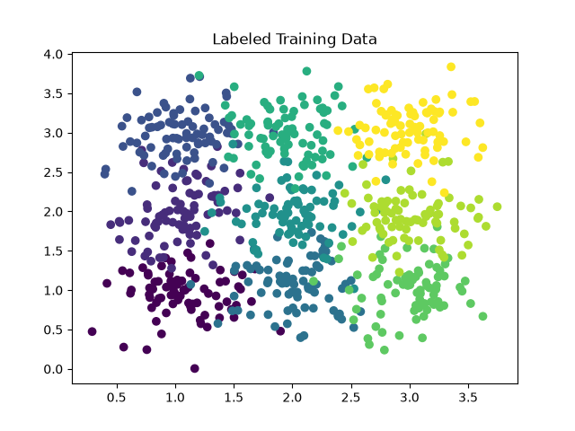
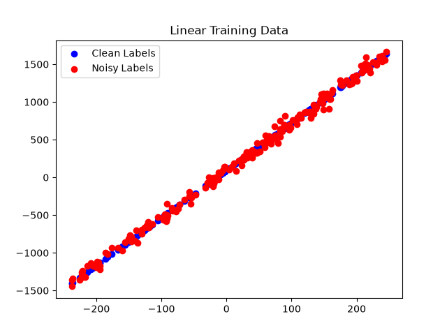

# Numpy ML

<p align="center">

</p>


- Neural Network
-- Linear Layers
-- Loss Functions
--- BCE Loss
--- Cross Entropy Loss
--- MSE Loss
-- Activation Functions
--- ReLu
--- LeakyReLu

Completed:
- K-Means

- KNN Classification

- MinMaxScaler

# K-Means Example
# KNN Example
# Linear Regression Example? (maybe not)

# neural network example

# Training Curves
# Toy Example
# MNIST Example

# Numpy ML
This repository holds numpy implementations of common machine learning algorithms

## Datasets
### GridDataSet

The Grid Dataset is sampled from 9 gaussian distributions with distinct means and the same variance (5).

Standard Means:
```
Cluster: 0 -> Mean: (1, 1)
Cluster: 1 -> Mean: (1, 2)
Cluster: 2 -> Mean: (1, 3)
Cluster: 3 -> Mean: (2, 1)
Cluster: 4 -> Mean: (2, 2)
Cluster: 5 -> Mean: (2, 3)
Cluster: 6 -> Mean: (3, 1)
Cluster: 7 -> Mean: (3, 2)
Cluster: 8 -> Mean: (3, 3)
```

The following is a visual representation of the train dataset:
<p align="center">

</p>

### Linear Dataset

Ground Truth Formula: `y = mx + b` where `m=6.3` and `b=92.4`

The dataset `x` range is `[-250, 250]`

<p align="center">

</p>

## K-Means

```python
from data_generator import GridDataSet
from numpy_ml.k_means import KMeans

# Initialize Dataset
dataset = GridDataSet()

# Create KMeans
kmeans = KMeans(k=9)

# Fit data to get k centroids
centroids = kmeans.fit(dataset.train_data)

# Assign cluster labels to test dataset
labels = kmeans.predict(dataset.test_data)
```

### Predicted Centroids for GridDataSet
```
[
 [2.38650151 2.9756075 ]
 [0.97735307 0.9429869 ]
 [2.98404367 1.06440087]
 [0.90746936 3.01740384]
 [1.72529989 2.94044173]
 [1.24654006 2.01424983]
 [3.08930462 2.89505338]
 [2.70143322 2.0085571 ]
 [1.99192699 1.07864197]
]
```

### Labels for GridDataSet
<p align="center">

</p>

## K Nearest Neighbors (KNN)

```python
from numpy_ml.knn import KNN
from data_generator import GridDataSet

# Initialize Dataset
dataset = GridDataSet()

# Create K-Nearest Neighbors
knn = KNN()

# Give KNN the datasets
knn.fit(dataset.train_data, dataset.train_labels)

# Predict Class Labels for Test Data with k neighbors
predicted_labels = knn.predict(dataset.test_data, k=3)
```

## Neural Network

```python 
from numpy_ml.neuarl_network import LinearLayer, ReLu
```
